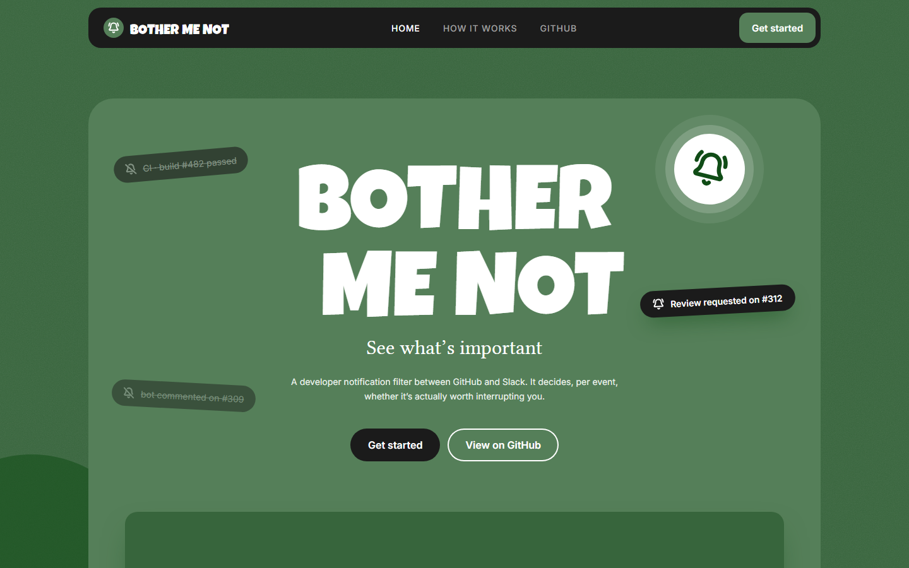
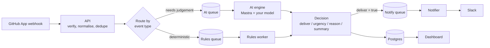

<p align="center">
  
</p>

# Bother Me Not

**See what's important.** Bother Me Not is a developer notification filter that sits between GitHub and Slack. Every event is judged on its own, and only the ones worth an interruption reach you.

Most notification tools deliver everything and leave the filtering to you. Bother Me Not filters first: a CI run that passed, a bot comment, or a label change is dropped quietly, while a review request or a failing build on your branch gets through.

## How it works

1. **Connect GitHub.** Install the GitHub App on the repositories you care about. Pull request comments, reviews, CI runs and issue updates flow in as webhooks.
2. **Judge each event.** Every event is evaluated on its own: is it about you, is it blocking, has it changed state? The evaluator returns a decision with `deliver`, `urgency`, a `reason`, a one-line `summary` and a `score` from 0 to 100.
3. **Ping only what matters.** Events the evaluator approves are delivered to your Slack channel. Everything else stays in the project's alert history, so you can always see what was skipped and why.

### The pipeline



- **One decision contract.** The AI engine and the rules worker return the same shape, so everything downstream (storage, delivery, the dashboard) is identical whichever one ran.
- **Bring your own model.** Each project can store its own AI provider key (Google, Anthropic or OpenAI). Keys are encrypted at rest with AES-256-GCM, are write-only, and only the last four characters are ever shown.
- **Reliable by design.** Jobs run on BullMQ with retries and exponential backoff. Webhooks are verified by HMAC signature and duplicate deliveries are ignored.

## The product

Bother Me Not is organised around one idea: **a project is its own workspace.** Nothing is shared between projects, so one repository's noise never mixes with another's.

```
Connectors            where events come from (GitHub; more sources to follow)
   └── Projects       pick the project you want to work in
         └── Project workspace
               ├── Alerts       every event and what was decided, newest first (opens here)
               ├── AI context   what the AI is told about this project
               ├── Rules        per-project rules for events that need no judgement
               ├── Deliveries   where each alert went
               └── Settings     name, GitHub repositories, AI model, delete
```

| Screen | What you do there |
| --- | --- |
| **Connectors** | The first screen after sign-in. Choose the source your events come from. |
| **Projects** | Create a project, or open one. Each project is a workspace for one set of repositories. |
| **Alerts** | Browse everything the system received, filtered by *All*, *Delivered*, *Skipped* or *Failed*. Each card shows the AI's summary, reason and score, with a link back to GitHub. |
| **AI context** | Describe what matters in this project (up to 2000 characters). It is added to the AI's prompt for every event. |
| **Rules** | Add deterministic rules for the events that need no model. |
| **Deliveries** | See where every approved alert was sent, and whether it arrived. |
| **Settings** | Connect repositories, set the project's AI provider and key, rename or delete the project. |

### Design

The interface is built from a small token set so every screen shares one look.

| Token | Value | Used for |
| --- | --- | --- |
| Forest green | `#255d2b` `#37653c` `#557f59` | Backgrounds, frosted workspace panels |
| Ink | `#1b1b1b` | Navigation, primary buttons |
| Signal | `#d8f263` | The lime accent: focus rings and highlights |
| Paper | `#f4f2e9` | Sign-in card and form surfaces |
| Display type | Luckiest Guy | Wordmark and headings |
| Body type | Inter, Libertinus Serif, DM Mono | Interface text, taglines, code |

Each page sits on a grainy green background with soft blobs, inside a frosted workspace beside a slim icon sidebar. Outside a project the sidebar shows *Connectors* and *Projects*. Inside a project it switches to that project's own pages, with a way back to *All projects*. On phones the sidebar becomes a bottom bar.

## Tech

| Layer | Choice |
| --- | --- |
| Web | React, React Router, TanStack Query, CSS modules, Vite |
| API | Fastify, Zod contracts shared with the web app |
| Queues | BullMQ on Redis |
| AI engine | Mastra with Gemini by default, or your own provider key |
| Data | PostgreSQL with Drizzle ORM migrations |
| Monorepo | pnpm workspaces |

```
apps/
  api/         webhooks, auth, projects, alerts
  ai-engine/   evaluates events with an AI model
  worker/      rules evaluation and delivery
  web/         the dashboard
packages/
  contracts/   Zod schemas shared by api and web
  db/          schema, migrations, repositories, encryption
  domain/      event normalisation
  queue/       BullMQ queues and enqueue helpers
  notify/      delivery channels
  config/      environment validation
```

## Run it locally

You need Node.js, pnpm and Docker.

```bash
pnpm install
docker compose up -d          # Postgres on :5435, Redis on :6379
cp .env.example .env          # then fill in the values described inside
pnpm db:migrate
pnpm dev                      # api, ai-engine, worker and web together
```

Open <http://localhost:5173>, sign in with GitHub, create a project and connect a repository.

`.env.example` explains every variable, including how to create the GitHub OAuth App and GitHub App, and how to generate the `JWT_SECRET` and `ENCRYPTION_KEY` values. Back up `ENCRYPTION_KEY`: if it is lost, saved AI keys can no longer be read.

## Learn more

The design decisions behind the pipeline are in [`docs/architecture.md`](docs/architecture.md).
